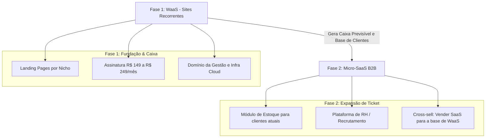

# 01 - Modelo de Negócios da Boomo: WaaS (Website as a Service)

## 1. Visão Geral
A Boomo opera no modelo **WaaS (Website as a Service)**, fornecendo presença digital completa e profissional para negócios locais (clínicas, escritórios, consultorias e comércio) através de um modelo de assinatura recorrente mensal.

Em vez de vender o site como um produto pontual ("venda única"), vendemos a **Gestão e Paz de Espírito Digital contínua**.

---

## 2. O Que Está Incluso na Assinatura para o Cliente
1. **Landing Page de Alta Conversão:** Rápida, moderna, adaptada para celular (mobile-first).
2. **Infraestrutura Completa:** Registro do domínio `.com.br`, hospedagem em nuvem segura e certificado SSL.
3. **Conversão Direta:** Botão flutuante de WhatsApp estrategicamente posicionado e links para redes sociais.
4. **Localização & Presença:** Integração com Google Maps e endereço físico.
5. **SEO Local:** Otimização para os mecanismos de busca do Google encontrarem o negócio na região.
6. **Manutenção Preventiva e Evolutiva:** Alteração de horários, números de telefone, fotos e pequenos textos sem cobranças adicionais.

---

## 3. Tabela de Precificação Sugerida

| Plano | Setup (Inicial) | Mensalidade | Perfil de Cliente |
| :--- | :--- | :--- | :--- |
| **Essencial** | R$ 300 | **R$ 149 / mês** | Negócios que precisam apenas de uma página institucional rápida (ex: prestadores de serviço solo). |
| **Pro (Recomendado)** | R$ 500 | **R$ 249 / mês** | Clínicas, consultórios e empresas com ponto físico que precisam de SEO Local e suporte ágil. |
| **Personalizado** | R$ 1.500+ | **R$ 399 / mês** | Empresas com necessidades específicas ou múltiplos produtos/filiais. |

---

## 4. Projeção de Faturamento e Meta de Saída da CLT

*   **Meta 1 (Validação):** 5 clientes a R$ 249/mês = **R$ 1.245 / mês** de receita recorrente.
*   **Meta 2 (Segurança):** 20 clientes a R$ 249/mês = **R$ 4.980 / mês**.
*   **Meta 3 (Transição Total):** 40 clientes a R$ 249/mês = **R$ 9.960 / mês**.

> **Custo Operacional Estimado:** Menos de R$ 150/mês para manter toda a infraestrutura de 40 clientes na nuvem.

---

## 5. Roadmap Visual da Empresa (WaaS ➔ Micro-SaaS)

