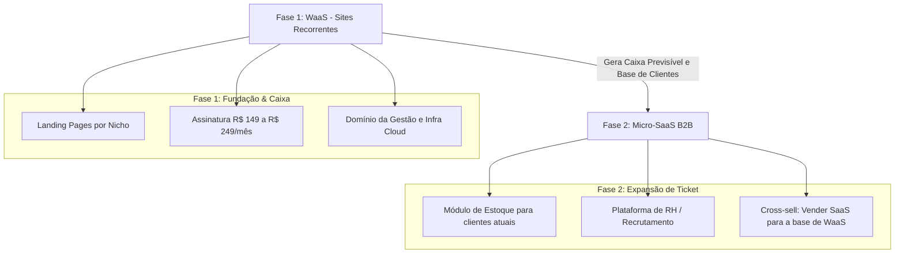

# 02 - Stack Tecnológica e Roadmap para Micro-SaaS

## 1. A Stack: DATH + Postgres
Para maximizar a produtividade de um desenvolvedor solo (Solo Founder), a Boomo adota a seguinte arquitetura:

*   **Backend:** Python com **Django** (segurança, robustez, ORM completo e Django Admin nativo).
*   **Interatividade Frontend:** **HTMX** (permite atualizar partes da página via requisições HTTP dinâmicas sem complexidade de SPAs).
*   **Comportamento Reativo Leve:** **Alpine.js** (para modais, dropdowns, toggles de temas e micro-interações no cliente).
*   **Estilização:** **Tailwind CSS** (design system ágil e consistente).
*   **Banco de Dados:** **PostgreSQL** (relacional, confiável e padrão de mercado).

---

## 2. Por que esta Stack é a Melhor Escolha?
1. **Zero Overengineering:** Elimina a necessidade de gerenciar repositórios separados para frontend e backend, bibliotecas de gerenciamento de estado complexas (Redux/Zustand) e dores de cabeça com hidratação e CORS.
2. **Django Admin como Backoffice:** Você ganha um painel administrativo pronto de graça para gerenciar clientes, domínios e assinaturas.
3. **Escalabilidade Garantida:** Quando o negócio exigir sistemas mais complexos (SaaS), a estrutura já está pronta para suportar milhares de acessos com segurança bancária.

---

## 3. Roadmap de Evolução (Em 2 Fases)

### A Vantagem Estratégica do Roadmap:
Na Fase 2, o custo de aquisição de clientes (CAC) para os seus sistemas SaaS será **zero**, pois você oferecerá os softwares diretamente para os donos de clínicas e empresas que já contratam o seu site institucional.
